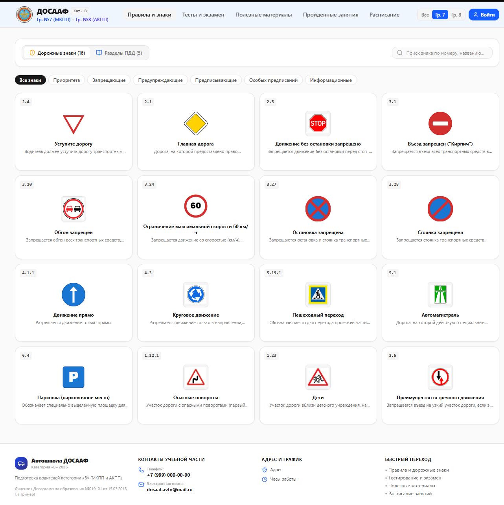

<div align="center">


# ДОСААФ — учебный портал автошколы

Веб-приложение для подготовки курсантов к теоретическому экзамену в ГИБДД
и для управления учебным процессом автошколы.




</div>

---

## Содержание

- [Возможности](#-возможности)
- [Что нового в v0.11](#-что-нового-в-v011)
- [Технологии](#-технологии)
- [Быстрый старт](#-быстрый-старт)
- [Настройка `.env`](#-настройка-env)
- [Обновление сайта на сервере](#-обновление-сайта-на-сервере)
- [Структура проекта](#-структура-проекта)
- [API](#-api)
- [База данных](#-база-данных)
- [Безопасность](#-безопасность)
- [Источники учебных материалов](#-источники-учебных-материалов)
- [Автор](#-автор)

---

## ✨ Возможности

### Для курсантов

- 📖 **Правила и знаки** — разделы ПДД и полный каталог дорожных знаков (316 знаков по Приложению 1 к ПДД) с официальными описаниями, фильтрами по группам и поиском
- 📝 **Тематические тесты** по разделам ПДД
- 🚦 **Пробный экзамен ГИБДД** — 20 случайных вопросов из 800 по правилам настоящего экзамена
- 🎓 **Государственный экзамен** — выбор билета, строгий режим, контроль ухода со вкладки
- 🔍 **Увеличение картинки вопроса** по нажатию, с текстом вопроса под ней
- 📚 Учебные материалы, 📅 расписание, 📊 личная статистика
- 👤 Профиль курсанта со сменой пароля и матрицей доступа к разделам

### Для администраторов

- 👥 Управление курсантами и группами (создание, блокировка, допуск к экзамену, число попыток)
- ❓ Банк вопросов: создание, редактирование, распределение по билетам, включение в экзамен
- 📡 **Мониторинг в реальном времени** — кто сейчас сдаёт экзамен, на каком вопросе, сколько ошибок
- 📋 Журнал действий (входы, смена паролей, нарушения режима экзамена, результаты)
- 📥 Экспорт ведомости экзамена в CSV (Excel)
- 🎨 Визуальный редактор блоков, переключатель темы (светлая / тёмная / фирменная ДОСААФ)
- ⚙️ Настройка вкладок навигации и подвала сайта
- 🔑 Восстановление пароля администратора по коду на email

---

## 🆕 Что нового в v0.11

- **800 вопросов** из 40 экзаменационных билетов ГИБДД категорий A, B, M — с картинками и правильными ответами. Вопросы добавлены в банк как «исключённые из экзамена», администратор сам решает, какие из них включить.
- **Пробный экзамен ГИБДД**:
  - 20 случайных вопросов, 20 минут;
  - без ошибок — экзамен сдан;
  - 1 ошибка — ещё 5 дополнительных вопросов и 5 минут, ошибаться в них нельзя;
  - 2 ошибки и больше — экзамен не сдан.
- **Экран входа с реальной загрузкой**: проверка логина и пароля, загрузка данных с сервера (прогресс по реально полученным байтам), изображений и шрифтов. Анимация — вращающееся колесо с дымом.
- **Полный каталог дорожных знаков** — 316 знаков, включая знаки сервиса и таблички, с векторными изображениями.
- **Увеличение картинки вопроса** в тестах по нажатию.
- `start.bat` сам устанавливает зависимости при первом запуске и не закрывается при ошибке.
- `deploy.bat` — копирование обновлений на сервер без затирания базы данных.

---

## 🛠️ Технологии

| Компонент | Технология |
|-----------|-----------|
| Фронтенд | React 19, TypeScript, Vite 6 |
| Стили | Tailwind CSS 4 |
| Анимации | Motion, canvas-confetti |
| Иконки | Lucide React |
| Бэкенд | Express 4 (`server.ts`, запуск через `tsx`) |
| База данных | SQLite через встроенный модуль `node:sqlite` (Node.js 22+) |
| Пароли | bcryptjs |
| Почта | Nodemailer (SMTP) |

---

## 🚀 Быстрый старт

### Требования

- **Node.js 22 или новее** (нужен встроенный модуль `node:sqlite`)
- npm (идёт вместе с Node.js)
- Windows, Linux или macOS

### Windows — одной кнопкой

Дважды щёлкните **`start.bat`**. При первом запуске он сам выполнит `npm install`, затем запустит сервер.

### Вручную

```bash
# 1. Установить зависимости
npm install

# 2. Создать файл настроек
cp .env.example .env        # Windows: copy .env.example .env

# 3. Запустить в режиме разработки
npm run dev
```

Сайт откроется на **http://localhost:3000**. Проверка сервера: http://localhost:3000/api/health

### Продакшен-сборка

```bash
npm run build   # собирает фронтенд в dist/ и сервер в dist/server.cjs
npm start       # запускает собранный сервер
```

---

## 🔧 Настройка `.env`

| Переменная | Назначение |
|------------|-----------|
| `SMTP_HOST` | SMTP-сервер для писем (по умолчанию `smtp.mail.ru`) |
| `SMTP_PORT` | Порт SMTP (по умолчанию `465`) |
| `SMTP_SECURE` | Использовать TLS (`true` / `false`) |
| `SMTP_USER` | Логин почтового ящика, с которого уходят коды восстановления |
| `SMTP_PASS` | Пароль приложения для этого ящика |
| `DISABLE_HMR` | `true` — отключить горячую перезагрузку Vite |

> ⚠️ Файл `.env` содержит пароли — **не добавляйте его в репозиторий**.

---

## 🔄 Обновление сайта на сервере

1. Остановите сервер (закройте окно `start.bat` или нажмите `Ctrl + C`).
2. Запустите **`deploy.bat`** — он скопирует папки `src` и `public` и несколько файлов конфигурации на сетевой диск `B:\DOSAAF`. Копируются только файлы новее серверных, ничего не удаляется.
3. Снова запустите `start.bat` на сервере.
4. Обновите страницу в браузере через `Ctrl + F5`.

> ⚠️ **Никогда не копируйте на сервер `dosaaf_data.sqlite`.** В нём живая база: курсанты, результаты, журнал. Замена этого файла сотрёт все новые данные на сервере. `deploy.bat` его не трогает.

Путь к серверу задаётся в начале `deploy.bat` (переменная `TARGET`).

---

## 📁 Структура проекта

```
DOSAAF/
├── server.ts                  # Express-сервер: API, SQLite, авторизация, мониторинг
├── start.bat                  # Запуск на Windows (с автоустановкой зависимостей)
├── deploy.bat                 # Копирование обновлений на сервер
├── dosaaf_data.sqlite         # База данных (создаётся автоматически, не в git)
├── public/
│   ├── pdd-tickets/           # 548 картинок к вопросам билетов ГИБДД (bXX_qYY.jpg)
│   ├── signs/                 # 316 изображений дорожных знаков (номер.svg)
│   ├── slideshow/             # Фоновые слайды экрана входа
│   └── sounds/                # Звуки результатов теста
└── src/
    ├── App.tsx                # Корневой компонент, экран входа и загрузки
    ├── types.ts               # Типы данных
    ├── context/
    │   ├── AppContext.tsx     # Состояние приложения и синхронизация с сервером
    │   └── DesignEditorContext.tsx
    ├── data/
    │   ├── initialData.ts     # Начальные данные, версия и журнал изменений
    │   └── signsCatalog.ts    # Каталог дорожных знаков (Приложение 1 к ПДД)
    ├── components/
    │   ├── TestsView.tsx      # Тесты, пробный экзамен ГИБДД, гос. экзамен
    │   ├── RulesAndSignsView.tsx
    │   ├── AuthGateScreen.tsx # Экран входа
    │   ├── LoginSuccessLoading.tsx
    │   ├── WheelLoader.tsx    # Анимация колеса с дымом
    │   ├── ZoomableImage.tsx  # Увеличение картинки вопроса
    │   ├── LiveMonitoringView.tsx
    │   └── ...
    └── utils/
        ├── exportExamSheet.ts # Выгрузка ведомости в CSV
        └── sound.ts
```

---

## 🔌 API

Все эндпоинты работают на порту `3000`.

| Метод | Эндпоинт | Описание |
|-------|----------|----------|
| `GET` | `/api/health` | Проверка работы сервера |
| `GET` | `/api/data` | Все сохранённые данные |
| `POST` | `/api/data` | Сохранить данные: `{ key, value }` или `{ data: { ... } }` |
| `POST` | `/api/auth/hash` | Хеширование пароля (bcrypt) |
| `POST` | `/api/auth/verify` | Проверка пароля |
| `POST` | `/api/auth/request-reset` | Отправить код восстановления на email |
| `POST` | `/api/auth/verify-reset` | Проверить код восстановления |
| `POST` | `/api/auth/consume-reset` | Использовать код и сменить пароль |
| `POST` | `/api/monitoring/update` | Обновить состояние сдачи экзамена курсантом |
| `GET` | `/api/monitoring/active` | Список активных сессий экзамена |
| `POST` | `/api/monitoring/stop` | Завершить сессию мониторинга |
| `GET` | `/api/monitoring/session/:userId` | Подробности сессии курсанта |

<details>
<summary>Примеры запросов</summary>

```json
// POST /api/data — одно значение
{ "key": "appTheme", "value": "dark" }

// POST /api/data — несколько значений
{ "data": { "appTheme": "dark", "footerSettings": { } } }
```

```json
// GET /api/data — ответ
{
  "success": true,
  "data": { "groups": [], "signs": [], "questions": [], "students": [] }
}
```

</details>

---

## 💾 База данных

Файл `dosaaf_data.sqlite` в корне проекта.

**Таблица `app_data`** — хранилище «ключ — значение»:

| Колонка | Тип | Описание |
|---------|-----|----------|
| `key` | TEXT | Уникальный ключ |
| `value` | TEXT | Значение (JSON) |
| `updated_at` | INTEGER | Время обновления (timestamp) |

**Таблица `reset_codes`** — коды восстановления пароля (хранятся в виде хеша, срок действия 15 минут, до 5 попыток).

<details>
<summary>Ключи в <code>app_data</code></summary>

| Ключ | Содержимое |
|------|-----------|
| `groups` | Группы курсантов |
| `students` | Учётные записи курсантов |
| `adminCredentials` | Данные администратора |
| `signs`, `signsCatalogVersion` | Дорожные знаки и версия загруженного каталога |
| `rules` | Разделы ПДД |
| `categories`, `questions` | Категории тестов и банк вопросов |
| `examSettings` | Настройки экзамена и занятые билеты |
| `testAttempts` | Результаты тестов и экзаменов |
| `lessons`, `schedule`, `materials` | Занятия, расписание, материалы |
| `activityLogs` | Журнал действий |
| `footerSettings`, `navTabs`, `siteInfo` | Настройки интерфейса, версия сайта |
| `appTheme`, `live_app_designs` | Тема и настройки визуального редактора |
| `access_requests` | Заявки на доступ |

</details>

---

## 🔐 Безопасность

**Уже сделано**

- ✅ Пароли хранятся в виде bcrypt-хеша (старые пароли в открытом виде автоматически переводятся в хеш при следующем входе)
- ✅ Восстановление пароля администратора по одноразовому коду на email (с ограничением попыток)
- ✅ Режим экзамена: запрет копирования, контроль ухода со вкладки с записью в журнал

**Планы**

- ☐ Серверная сессия (JWT или cookie) вместо проверки доступа на стороне клиента
- ☐ Проверка прав на запись в `/api/data` на сервере
- ☐ HTTPS (например, через Caddy или Cloudflare)
- ☐ Ограничение частоты попыток входа

---

## 📚 Источники учебных материалов

- Экзаменационные билеты ГИБДД категорий A, B, M и тексты Приложения 1 к ПДД — [pddmaster.ru](https://pddmaster.ru/)
- Изображения дорожных знаков — [Wikimedia Commons](https://commons.wikimedia.org/) (общественное достояние)

---

## 👤 Автор

**Мельник Сергей (SelJax)** — разработка портала для автошколы ДОСААФ.
